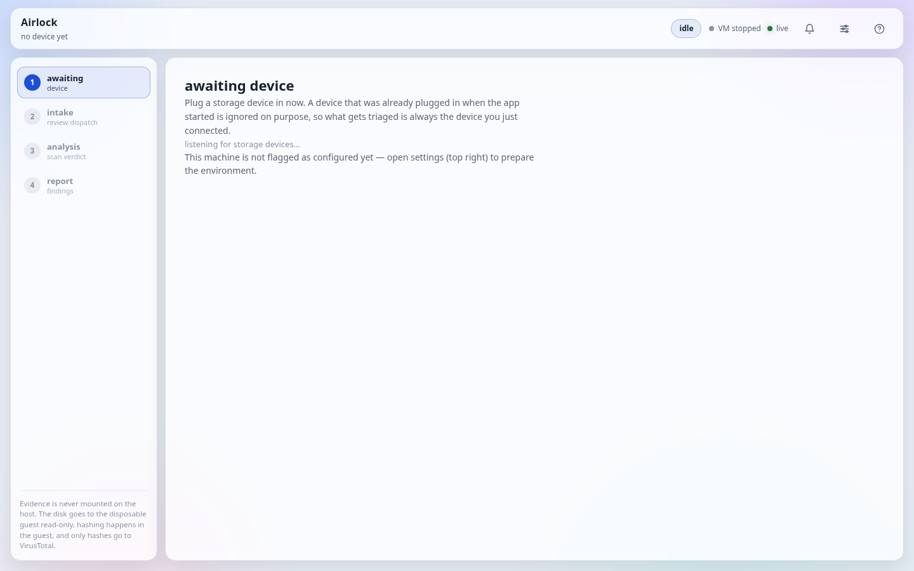
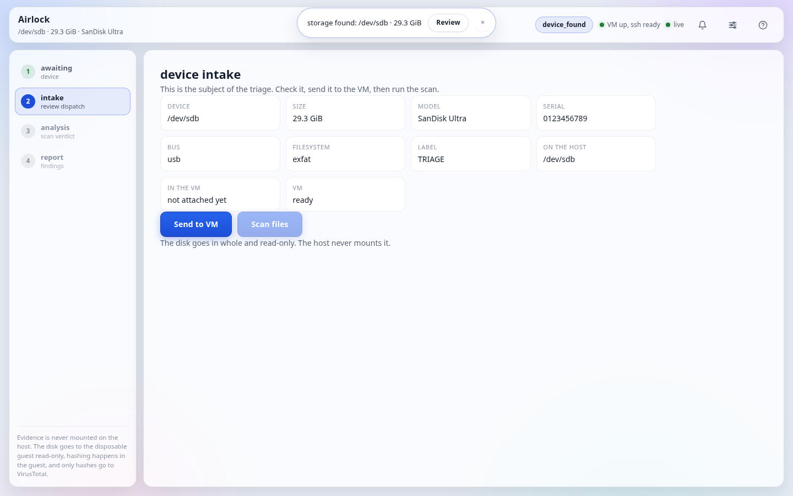
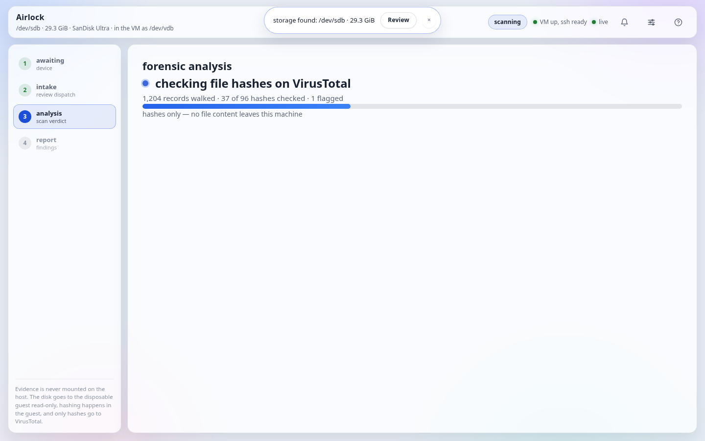
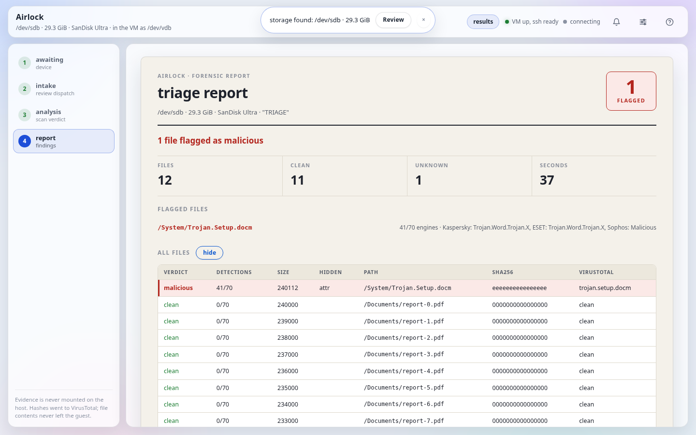

# Airlock

USB storage forensics through an isolation chamber. Plug a suspect drive in
and the app walks itself through the investigation: it boots a disposable
guest VM, hands the whole disk to the guest **read-only**, hashes every file
**inside the guest**, checks the hashes against VirusTotal **from the host**,
and presents a verdict with a PDF export. The evidence disk is never mounted
— or even touched — on the host. Unplug the drive at any point and everything
resets: the VM is destroyed and the UI returns to the start.

## Screens

| awaiting device | device intake |
|---|---|
|  |  |

| forensic analysis | triage report |
|---|---|
|  |  |

## The workflow

Four steps, one screen at a time. The rail on the left always shows where the
case stands; only the current step's panel fills the screen.

1. **awaiting device** — the app listens for block devices that appear
   *after* startup. Anything already plugged in is ignored on purpose, so the
   subject is always the drive you just connected. An arrival raises a toast
   alert instead of a step, and auto-boots the VM.
2. **device intake** — the subject's facts (device node, size, model, serial,
   bus, filesystem, label, host/guest attachment, VM status). **Send to VM**
   stays disabled until the guest's SSH is up; **Scan files** stays disabled
   until the disk is inside the guest. The next move is always visible, never
   clickable too early.
3. **forensic analysis** — one live status line ("walking /dev/vdb1…", then
   "checking file hashes on VirusTotal"), live counters, and a progress bar
   that crawls while walking (no total exists) and fills by percent while
   checking hashes.
4. **triage report** — one verdict sentence, four numbers (files / flagged /
   clean / unknown), the flagged files with engine names, then every file in a
   table (flagged first). Two buttons only: **Stop VM** (destroys the guest)
   and **Export report** (the same report as a printable PDF).

Stopping the app, stopping the VM, or simply unplugging the drive all end in
the same place: no guest, no subject, back to step 1.

## How we built the golden image

`tiny-linux/build_golden_image.py` builds a minimal Alpine-based guest whose
only job is to mount one read-only disk, walk it, and hash what it finds.

- **Rootless by design.** Alpine packages are fetched and unpacked as plain
  files (`tar --no-same-owner`), the ext4 root filesystem is assembled with
  `mke2fs -d` (no loop mounts), and the boot initramfs is packed with `cpio`.
  No chroot, no mounts, no root — except one call: sshd's
  privilege-separation directory must be root-owned or sshd refuses to start.
  That call runs under `fakeroot` when the builder isn't root, which also
  makes every other file in the image correctly root-owned (a rootless build
  without it would bake in uid 1000 everywhere, including root's
  `authorized_keys`, and SSH into the guest would fail).
- **Deliberately small package set** (`PACKAGES` in the script): `python3`
  (the collector is a script), `openssh`, `coreutils`, `findutils`,
  `util-linux` + real `losetup`/`blkid`/`sfdisk` (busybox versions can't do
  what the collector needs), `e2fsprogs` + `e2fsprogs-extra` (debugfs reads
  ext without mounting), `ntfs-3g`, `exfatprogs`, `fuse3`, `nftables`.
- **Kernel modules for filesystems** (`ANALYSIS_MODULES`): `exfat`, `ntfs3`,
  `vfat`, `udf`, `xfs`, `btrfs`, plus `loop` (a partition the kernel didn't
  scan, e.g. inside a container image, is only reachable through a private
  loop device) and the `nf_tables` set for the guest firewall.
- **Outputs** (all git-ignored, reproducible): `golden.qcow2` (ext4 root →
  qcow2 via `qemu-img convert`), `boot-initramfs.cpio.gz` (loads virtio/ext4,
  then `switch_root` into golden), `keys/golden_*` (baked guest host key and
  the host-side access key, generated with `ssh-keygen`).
- **Staging.** `triage_vm.stage_boot_files()` copies the image where QEMU can
  read it (`/var/tmp/storage-watcher`), and `libvirt_vm.access_problems()`
  verifies the `libvirt-qemu` user can actually read the kernel and initramfs
  — a private home directory (`drwx------`) otherwise kills the boot with a
  misleading "permission denied".

Rebuild anytime from Settings → golden image, or:
`cd tiny-linux && python3 build_golden_image.py` (needs root or `fakeroot`).

## Every piece of the project

### The app (host side)

| file | what it does |
|---|---|
| `web_server.py` | The whole HTTP layer: serves the UI, the JSON API, the WebSocket endpoint, and the PDF download. Owns `Actions` (the privileged half: boot/attach/scan/stop, device arrival + removal, environment checks, background image builds, the configured flag) and the scan worker (`_collect` polls the guest, `_enrich` checks hashes, `_scan_worker` ties them together off the request thread). Static assets are versioned by mtime so a deploy can never strand the browser on stale JS. |
| `triage_state.py` | The state machine and the single source of truth: `idle → device_found → attaching → attached → scanning → results`, plus `booting_vm`, `ready`, `tearing_down`, `error`. Every mutation notifies the live feed, so the UI never polls for changes. Also owns `allowed_actions` — the server refuses anything outside the current state's set. |
| `device_listener.py` | Polls block devices, ignores the startup baseline, waits out a settle delay, refuses the host root disk, and reports arrivals *and removals* to the app. Removal of the subject triggers the full reset. |
| `udev_monitor.py` | The raw block-device scan the listener polls (`/sys/class/block` + `blkid` probes). Also reused by `hook.py`. |
| `triage_vm.py` | Disposable-guest lifecycle: stage files, boot, prove SSH, attach the disk with `<readonly/>` **and then verify from inside the guest** (`blockdev --getro`) that it really landed read-only, detach-first destroy, `build_image()` with live progress streaming. |
| `libvirt_vm.py` | Thin libvirt/QEMU wrapper: domain XML, disk attach/detach, network setup, `access_problems()` readability checks. |
| `triage-network.xml` | The dedicated host↔guest network, defined once: `forward mode='none'` — no NAT, no uplink, no gateway. Host `.1`, guest static `.10` on `virbr-triage`. Stronger than guest firewalling, because a compromised guest kernel cannot invent a route that was never configured. |
| `virustotal.py` | Host-side, hash-only VirusTotal client. Sends SHA-256 strings, never file content or names. Deduplicates, caches on disk (configurable TTLs), throttles to stay under free-tier rate limits, checks *every* unique hash by default (`TRIAGE_VT_LIMIT` caps it), and stops the scan on quota exhaustion instead of hammering a refused key. A 204/unknown hash is "unknown", never "clean". |
| `live_feed.py` | Minimal RFC 6455 server on top of the stdlib HTTP server: handshake, text frames, ping/pong, close. One fan-out feed; slow browsers are dropped instead of buffered without bound; every socket needs the page's session token. State snapshots coalesce (throttled), log lines never do. |
| `webui/` | Dependency-free, full-screen stepper UI (`index.html`, `app.js`, `style.css`, light theme). One WebSocket drives everything; polling is only the fallback. Includes the events dialog, the settings dialog, and the four-page tour with real screenshots. |

### The guest side

| file | what it does |
|---|---|
| `tiny-linux/guest_collector.py` | The **only** thing that ever touches the evidence disk. Runs in the guest, in a private mount namespace: discovers partitions from the disk's *own* partition table (`sfdisk --json`, never trusted offsets from outside), mounts each `ro,noexec,nosuid,nodev,noatime`, falls back to private read-only loop devices, hashes files to 256 MB (`HASH_LIMIT`; larger files are recorded unhashed, never skipped silently), and streams JSON Lines (`type` = record kind, `kind` = entry kind — kept separate after one shared key broke the parser once) plus a `TRIAGE_COMPLETE` marker. One bad file is logged, never fatal. |
| `tiny-linux/build_golden_image.py` | The image builder described above. |
| `tiny-linux/kver` | Pins the kernel version the initramfs modules are built for. |

### Tests, settings, leftovers

| path | what it does |
|---|---|
| `tests/` | 77 unit + endpoint tests, all hermetic: `test_scan` (parser, collector contract, VT client, enrichment), `test_live` (frame codec against RFC vectors, feed fan-out, WS auth/push, PDF export, asset versioning, docs sandbox), `test_removal` (unplug reset, scan abandonment, listener removal wiring), `test_settings` (checks, background build, flag round-trip, rootless gating), `test_triage_safety` (attachment safety). Run with `python3 -m unittest discover -s tests`. |
| Settings (in-app) | Gear button → environment checks (image staged, libvirt can boot it, VT key present, buildable via root or fakeroot), background golden-image rebuild with live log, and the "mark as configured" flag (`~/.config/triage/configured`). Step 1 nudges here until flagged. |
| `hook.py`, `udev_gui.py`, `udev_control.py`, `boot-tiny-linux.sh`, `tiny-linux/build-tiny-linux.sh` | Legacy: an earlier direct-QEMU boot path and a generic device-hook runner + GUI. Not used by the libvirt app flow; kept for reference. |

## Network isolation

Three layers, each independent:

1. **Libvirt network** (`triage-network.xml`): `forward mode='none'`. The
   guest has no route off its bridge, by configuration rather than by
   filtering.
2. **Guest firewall**: `nftables` ruleset baked into the image.
3. **Direction of trust**: the guest can only ever see the host's SSH
   client and the attached evidence disk; VirusTotal traffic originates on
   the host.

## Requirements

- Linux host with KVM/libvirt, `virsh`, `python3`
- Guest build tools: Alpine fetch needs network; `mke2fs`, `cpio`,
  `qemu-img`, `ssh-keygen`, and `fakeroot` (or root) for building
- Python packages: `reportlab` (PDF export)
- A VirusTotal API key (free tier works; only hashes are ever sent)

## Quick start

```bash
# 1. put the VirusTotal key where the app reads it (0600, never in the repo)
mkdir -p ~/.config/triage && printf 'YOUR_KEY' > ~/.config/triage/virustotal
chmod 600 ~/.config/triage/virustotal

# 2. build the disposable guest (needs root or fakeroot)
python3 tiny-linux/build_golden_image.py
# or from the app: gear button → Build golden image

# 3. open settings (gear, top right), check the environment lines,
#    then "Mark as configured"

# 4. run the app (needs libvirt access for VM control)
python3 web_server.py
# open http://127.0.0.1:8765, take the tour, then plug a USB drive in
```

Stopping the app destroys the VM. Unplugging the drive mid-flow does the
same and returns the UI to the start.

## API

All state-changing calls need `X-Triage-Token` (the page embeds its own) and
must be in the current state's `allowed_actions`, otherwise 409.

| endpoint | what |
|---|---|
| `GET /` | the UI (assets versioned by mtime) |
| `GET /api/state` | full snapshot: state, device, VM, scan, report, events tail, environment flag |
| `GET /api/events?since=N` | log lines after N (fallback path) |
| `GET /live?token=` | WebSocket: `hello`, throttled `state`, unthrottled `log` pushes |
| `POST /api/action/<name>` | `start_vm`, `send_to_vm`, `scan_device`, `stop_vm`, `close_results`, `forget_device` |
| `GET /api/settings` | environment checks, build status + log tail, configured flag |
| `POST /api/settings/build` | background golden-image rebuild (202 accepted, 409 if busy) |
| `POST /api/settings/configured` | set/clear the configured flag |
| `GET /api/report.pdf` | the finished report as PDF (token in header or query) |
| `GET /docs/<name>` | example screenshots for the tour (sandboxed to `docs/`) |
| `GET /api/health` | `{"ok": true}` |

## Security notes

- Evidence is never mounted, or even touched, on the host.
- VirusTotal receives SHA-256 hashes only — never filenames with content,
  never file bytes.
- The browser session token gates actions, settings, export, and the
  WebSocket; the server binds to localhost only.
- The guest shares the host kernel, so a malicious filesystem is still
  host-kernel attack surface. Treat this as triage, not a sandbox proof.
